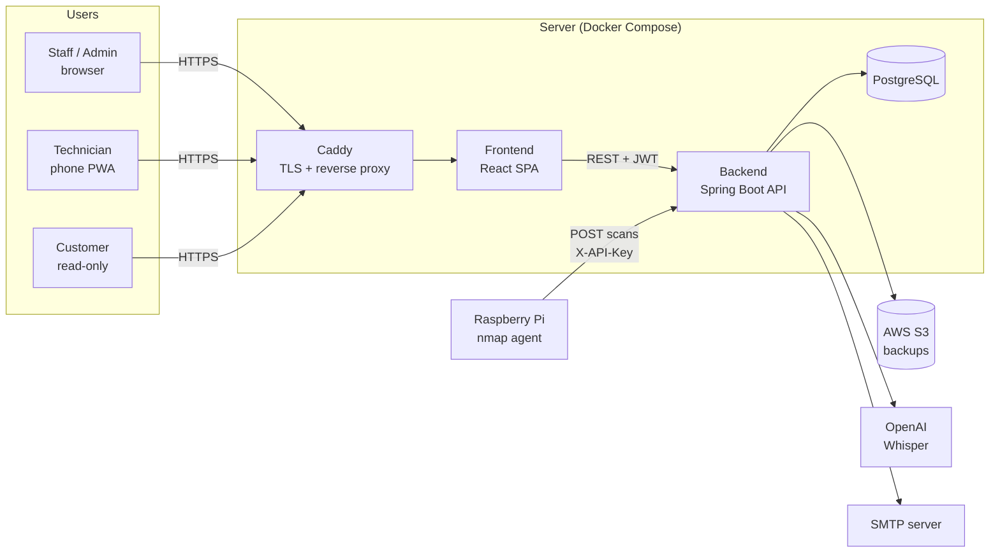

<p align="center">
  
</p>

<p align="center">
  <b>Network topology design and field-service management for IP camera and low-voltage installers.</b>
</p>

<p align="center">
  
  
  
  
  
  
</p>

---

## Why this exists

Companies that install CCTV, network and low-voltage systems usually keep their
customers' infrastructure in scattered places: a PDF floor plan here, a
spreadsheet of IP addresses there, paper service forms in the van. When
something breaks at 2 AM, nobody knows which switch port that camera is on.

FieldDesk puts it all in one place. Staff draw the network on top of the real
floor plan, technicians fill in signed service forms from their phones, and
each customer gets a read-only login to see their own live topology.

It was built for, and used in production by, a real installation company.

## Features

**Topology editor**
- Drag-and-drop editor on top of an uploaded floor blueprint (Leaflet)
- Device palette: cameras, NVRs, servers, switches, access points, sockets, workstations
- Connections with port numbers, cable types, solid/dashed lines and waypoints
- Rack cabinet view with slot-level management
- IP address and notes per device
- **PDF import**: extract devices from an existing PDF drawing (Apache PDFBox)
- **One-click PDF export** for audits and handover documents

**Field service**
- Mobile-first service form portal on its own subdomain (`servisform.*`), installable as a PWA
- Customer signature capture on the device
- **Voice-to-text**: technicians dictate the work done, OpenAI Whisper transcribes it
- AI-assisted service form templates (drafted with an LLM, editable by admins)
- Submitted forms are emailed as a styled HTML report to configurable recipients

**Network discovery**
- A small Python agent on a Raspberry Pi runs `nmap` on the customer's LAN
- Results are pushed to the backend and browsable in the admin panel, with
  per-agent retention and write-throttling settings

**Administration**
- 7 roles (`ADMIN`, `DEVELOPER`, `MANAGER`, `MODERATOR`, `TECH`, `CLIENT`, `CUSTOM`)
  with granular permissions for the `CUSTOM` role
- Customer and site management, per-client topology isolation
- Login analytics: success rates, failure reasons, suspicious IPs, active sessions per device
- Automated PostgreSQL backups to AWS S3 with retention and health charts
- Server metrics dashboard (Spring Boot Actuator)
- Full Turkish and English UI (i18next), light and dark theme

## Tech stack

| Layer | Technologies |
| --- | --- |
| **Frontend** | React 19, React Router 7 (framework mode), TypeScript, Vite 7, Tailwind CSS 4, shadcn/ui (Radix), TanStack Table, Recharts, Leaflet, dnd-kit, jsPDF, i18next |
| **Backend** | Java 25, Spring Boot 3.5, Spring Security, Spring Data JPA, JJWT, Bean Validation, Spring Mail, Apache PDFBox, AWS SDK v2 (S3), Actuator |
| **Database** | PostgreSQL 17 |
| **Infra** | Docker / Podman Compose, Caddy (automatic HTTPS), systemd |
| **Edge agent** | Python 3, nmap, Raspberry Pi |
| **External APIs** | OpenAI (Whisper + chat), SMTP |

## Architecture



## Security

Authentication is implemented from scratch on top of Spring Security rather than
delegated to a third-party provider:

- Passwords hashed with **BCrypt**
- Stateless **JWT** auth, but every token is also stored server-side, so sessions
  can be **revoked** individually ("log out this device") or all at once
- Old tokens from the same device/browser are revoked automatically on new login
- Account lock, disable and expiry checks on every request
- Email verification and password reset flows with rate-limited resend policies
- Every login attempt is recorded (IP, device, geolocation, failure reason) for the analytics dashboard
- Role-based access in the filter chain **plus** ownership checks in controllers,
  so a client can never read another client's topology
- The Raspberry Pi authenticates with a separate API key compared in **constant time**
- No secrets in the repository: everything is read from environment variables,
  production compose **fails fast** if the JWT secret is missing, and the
  bootstrap admin password is either supplied or randomly generated

## Getting started

### Prerequisites

- Docker or Podman (with compose)
- For running services outside containers: Java 25 and Node.js 22+

### Quick start (everything in containers)

```bash
git clone https://github.com/aardapeker/camera-network-app.git
cd camera-network-app
cp .env.dev .env          # dev defaults, no real keys needed
./dev.sh up               # db + backend + frontend with hot reload
```

| Service | URL |
| --- | --- |
| Frontend | http://localhost:5173 |
| Service-form portal | http://servisform.localhost:5173 |
| Backend API | http://localhost:8080 |

Sign in with **`root` / `admin123`** (dev only; set by `ADMIN_INITIAL_PASSWORD` in `compose.dev.yml`).

On Windows use `.\dev.ps1 up`. Other commands: `db`, `local`, `logs`, `build`, `reset`, `down`.

### Local development (faster feedback)

```bash
./dev.sh db                                    # only PostgreSQL in a container

cd backend && ./mvnw spring-boot:run           # terminal 1
cd frontend && npm install && npm run dev      # terminal 2
```

Optional integrations (mail, S3 backups, Whisper, the Pi agent) stay disabled
until you fill in their variables in `.env`. The app runs fine without them.

## Deployment

1. Point two DNS records at your server, e.g. `app.example.com` and `servisform.example.com`
2. Copy `.env.example` to `.env` and fill it in. At minimum:
   `POSTGRES_PASSWORD`, `JWT_SECRET` (`openssl rand -base64 32`), `APP_DOMAIN`,
   `PORTAL_DOMAIN`, `CORS_ALLOWED_ORIGINS`
3. Start the stack:
   ```bash
   docker compose up -d --build
   ```
4. Caddy fetches TLS certificates automatically. If you left
   `ADMIN_INITIAL_PASSWORD` empty, grab the generated root password from
   `docker compose logs backend` and change it after your first login.

## Network scanner agent

The `pi-scanner/` folder contains a tiny Python service for a Raspberry Pi
installed on the customer's network. See [`pi-scanner/README.md`](pi-scanner/README.md)
for setup. In short: copy three files, set `BACKEND_URL`, `API_KEY` and
`SUBNET`, and enable the systemd unit.

## Project structure

```
.
├── backend/            Spring Boot API
│   └── src/main/java/com/aardapeker/app/
│       ├── security/   JWT + API-key filters, security config
│       ├── controller/ REST endpoints
│       ├── service/    business logic
│       ├── policy/     authorization and rate-limit rules
│       ├── networkscan/, serviceform/, formtemplate/, audio/, pdf/, customer/ ...
│       └── scheduler/  cleanup jobs (expired tokens, PDF sessions, old scan data)
├── frontend/           React Router 7 SPA
│   └── src/
│       ├── routes/     pages (admin panel, editor, service forms, portal)
│       ├── components/ UI, Leaflet editor, analytics charts
│       ├── hooks/      topology state, PDF export ...
│       └── locales/    tr.json, en.json
├── pi-scanner/         Raspberry Pi nmap agent
├── docs/               deeper guides (see below)
├── compose.yml         production stack (Caddy + db + backend + frontend)
├── compose.dev.yml     development stack with hot reload
└── Caddyfile
```

## Documentation

- [Service-form portal](docs/service-form-portal.md): how the `servisform.*` subdomain works
- [S3 backup setup](docs/backup-s3-setup.md): IAM user, bucket and retention
- [API testing with curl](docs/api-testing-with-curl.md)
- [Podman development](docs/podman-development.md) and the [Docker/Podman cheatsheet](docs/docker-podman-cheatsheet.md)

## Author

Built by **Arda Peker** ([@aardapeker](https://github.com/aardapeker)), an
electronics and communications engineer who installs these camera systems in
the field and got tired of drawing them on paper.

## License

[MIT](LICENSE)
